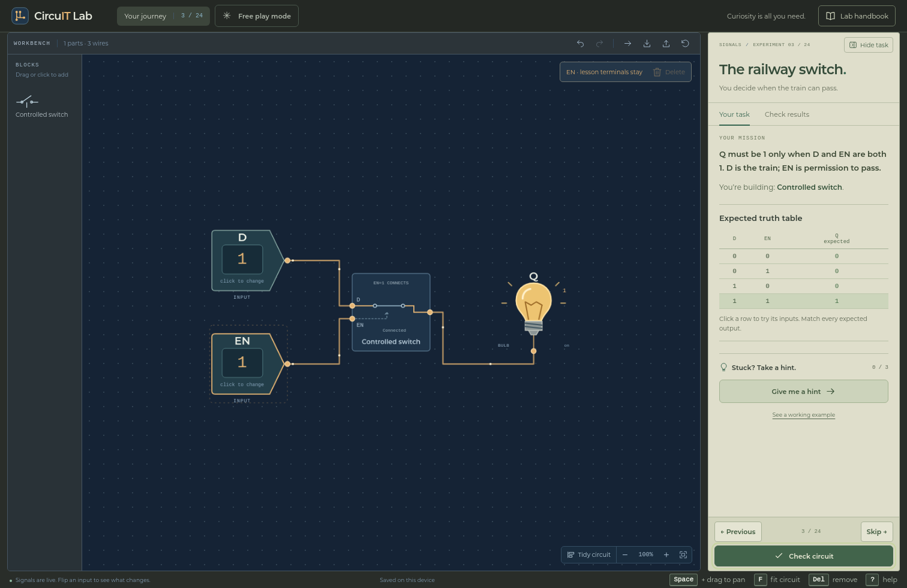

# CircuIT Lab

**Switch it. Wire it. Make it work.**

Curiosity is all you need. Build logical circuits through 24 discoveries, from a signal and a bulb to a four-bit processor. Explore controlled switches, build NAND as your first logic gate, then use earlier discoveries to build gates, arithmetic, and memory.



## Run from source

Install Python 3.10+ and either Docker or [Emscripten](https://emscripten.org/docs/getting_started/downloads.html). The Emscripten option also needs CMake 3.16+ and a supported build tool such as Make or Ninja. Docker supplies the compiler and build tools through a pinned official Emscripten image; its first download is sizeable.

```sh
git clone https://github.com/senqx/circuit-lab.git
cd circuit-lab
python3 serve.py
```

If you downloaded the source as an archive, extract it and run `python3 serve.py` from that folder instead. Run the commands below from the repository root too.

Open the printed address. The launcher compiles the C++ engine to WebAssembly, assembles `dist/app/`, and serves it at `http://127.0.0.1:8000`. If that port is busy, it chooses another. Stop the server with Ctrl+C. After building, you can start without the compiler:

```sh
python3 serve.py --no-build --port 18437
```

Normal web play needs no npm packages, Python packages, native API, or production hosting configuration. `requirements.txt` is only for hosting the optional native API with Gunicorn. The launcher loads `src/server/` only when `--native-api` is selected.

Simulation runs locally in a Web Worker. After the first successful load and offline cache installation, the game can reopen without the server or an internet connection. HTTPS (or localhost) enables offline caching and installation. Browser installation controls can add the game to a desktop or home screen. Rebuild after changing source; close existing game tabs to activate a cached update.

## Run a built copy

The complete `dist/app/` folder is the playable application: it includes the UI, compiled WebAssembly engine, fonts, and offline assets. It is generated and excluded from Git, so a source download must be built first. To share a built copy, distribute all of that folder's contents together.

Serve the folder through a static HTTP server. For example, if Python is available, this command serves a locally built bundle:

```sh
python3 -m http.server 8000 --bind 127.0.0.1 --directory dist/app
```

Open `http://127.0.0.1:8000`. If you received only the bundle, run the command inside its extracted folder and omit `--directory dist/app`. Playing a built copy needs a modern browser and a static server; a compiler, Docker, and the source repository are unnecessary. Python is just one choice of static server. Use an HTTP address so browser modules and workers can load correctly.

## Publish the web application

The release is a static application: publish the contents of `dist/app` to a static HTTPS host, including GitHub Pages. The same folder is the application bundle for future mobile and desktop shells. Build it separately with:

```sh
python3 scripts/build_app.py
```

The production container builds the WebAssembly engine and serves the application through unprivileged Nginx. It needs no Python runtime or simulation backend:

```sh
docker build -t circuit-lab:release .
docker run --rm -p 127.0.0.1:8000:8080 circuit-lab:release
```

See [deployment instructions](docs/DEPLOYMENT.md) for static hosting, updates, containers, and the optional native HTTP service. [Platform integration](docs/PLATFORMS.md) explains shared code and the remaining work for packaged apps. [Release validation](docs/RELEASE.md) records the validation scope.

## Learn and experiment

The handbook opens on the first visit. Read the task, place parts from the left tray, connect their dots, change the inputs, and check the circuit against its expected truth table or clock sequence. The interface teaches logic without requiring electrical terminology. Choose **Lab handbook → Circuit design** for a short introduction to Boolean algebra, building from truth tables, and simplifying circuits. The handbook contents link directly to each topic.

| Chapter | Discoveries |
| --- | --- |
| Signals | A signal link, constant 1, controlled switch |
| Rules | NAND → NOT → AND → OR → XOR → multiplexer → demultiplexer |
| Numbers | Half adder, full adder, four-bit NOT, AND, ripple-carry adder |
| Calculator | Zero detector, four-bit multiplexer, arithmetic logic unit |
| Memory | One-bit storage, enabled register, counter, address decoder |
| Computer | Two-word RAM, four-bit processor |

Drag or click to add blocks. Click two pins or drag between them to connect. Drag a connected receiving pin to move that wire's end; Escape, right-click, or an empty drop cancels. Select with a desktop-style selection box or modifier-click, and use **Del** to remove. Lesson terminals stay on the board. **Tidy circuit** arranges a messy layout, and Undo restores it.

**Space-drag** or middle-drag pans, scrolling or pinching zooms, and **F** fits the board. **?** opens the handbook. The task and chapter path can be hidden for more room. Gold wires flow only while carrying a nonzero signal; zero wires remain still. Motion can be paused and respects reduced-motion settings.

**Previous** returns to saved work. **Next** unlocks after a successful check; **Skip** asks before leaving an unfinished experiment. Hints and worked examples are available, and exploring an example does not mark a lesson complete. **Free play mode** provides all the parts, import/export, and a return to your last lesson.

First make the circuit work, then try an **optional NAND challenge**. Eight lessons offer compact two-input NAND targets, from one NAND for NOT to nine for a full adder. Correct mixed-gate circuits still pass. The engine counts all blocks on the board, and your best checked NAND-only count is saved. The handbook explains how to build from a truth table, simplify Boolean expressions, and share intermediate results. Real chips use mixed gate libraries; NAND count is a learning metric.

A controlled switch's contact follows EN, while the bulb shows the data that passes through it. EN=1 with D=0 closes a normal switch and leaves the bulb off. An unwired EN shows **? · defaults to 0**: normal switches start open, active-low switches start closed. A wired unknown signal stays unknown.

Circuits, inputs, and progress save in this browser. Export JSON files to keep or share them. Memory starts at zero when reopening a workspace. Existing `signal-garden-v2` saves and lesson IDs are preserved, including the NAND-first ordering; supported version-1 saves migrate without deleting their originals.

## One engine, different interfaces

```text
Browser / PWA / future mobile or desktop shell
    → Shared UI → Web Worker → C ABI → C++ engine (WebAssembly)

Optional integrations → C++ API or Python HTTP adapter → Same engine (native)
```

The C++17 library owns all component definitions, signal propagation, validation, memory, lesson specifications, and checking. Advanced blocks expand into ordinary circuits made from earlier parts. JavaScript handles editing, presentation, and argument conversion. The optional Python adapter supports native integrations. Neither implements gate evaluation.

The chosen direction for mobile and desktop is the same UI and WebAssembly engine, with small platform adapters where needed. The UI uses standard HTML, CSS, JavaScript, and SVG. Responsive layouts and pointer events are shared; native shell selection, OS integrations, and testing on actual devices remain future work. There are no native app projects or installers yet.

Independent behavioral specifications deliberately check the recipes against expected answers. Alternative constructions and unused unwired parts are accepted; using the finished target chip cannot complete its own lesson.

## Project structure

```text
src/
  engine/           Shared C++ engine, catalog, lessons, and public APIs
  ui/               Shared interface, assets, and WebAssembly bindings
  server/           Optional native HTTP adapter
  http_headers.py   HTTP policy shared by the launcher and native adapter
scripts/            Build, packaging, and deployment checks
tests/              Engine, transport, editor, and browser tests
examples/           Small native C++ client
docs/               Engine, deployment, platform, and validation guides
deploy/             Hosting configuration
build*/             Generated compiler output and caches
dist/app/           Generated portable application bundle
CMakeLists.txt      Engine build entry point
Dockerfile          Production container build entry point
serve.py            Local launcher
README.md
LICENSE
```

Application code lives in `src/`; build tools, tests, and hosting configuration are grouped by their own responsibilities. Standard tool entry files stay at the root. `build*`, `dist`, `.venv*`, `test-artifacts`, caches, and local tool metadata are excluded from Git and release sources. Build output is also excluded from container build input.

Edit circuits and lesson behavior in `src/engine/`, and the interface in `src/ui/`. `src/ui/engine/` contains the worker and C-ABI bindings; `src/ui/platform.mjs` handles storage, files, lifecycle events, and offline setup. `python3 scripts/build_app.py` assembles the UI and compiled engine into `dist/app/`. Add native shell projects under `platforms/<shell>/` when a packaging framework is selected.

The web build requires `src/engine/`, `src/ui/`, `CMakeLists.txt`, `scripts/build_app.py`, and `LICENSE`. The local launcher additionally uses `src/http_headers.py`. Tests, examples, documentation, `src/server/`, and `deploy/` support development or optional integrations; they are not required to build the static game. The native CMake build also builds `examples/native.cpp` and, by default, the engine tests.

Read [engine design and integration](docs/ENGINE.md) for the APIs, signal states, clock semantics, and rendering architecture. Future native or mobile interfaces can reuse the engine without changing the circuit rules.

## Validate changes

The C++ sources follow the [project coding conventions](docs/CPP_STYLE.md).
`.clang-format` targets clang-format 20; naming, ownership, and the documented
layout exceptions also need a manual review. The C++ interface is
`signal/engine.h` in namespace `circuit`. The Python and WebAssembly adapters
use the [`circuit_*` C ABI](docs/ENGINE.md#c-abi).

Native checks need CMake 3.16+ and a C++17 compiler. WebAssembly parity checks also
need Node.js 22+ and a built application bundle.

```sh
cmake -S . -B build -DCMAKE_BUILD_TYPE=Release
cmake --build build --parallel 4
ctest --test-dir build --output-on-failure
python3 scripts/build_app.py
python3 -m unittest discover -s tests -p 'test_*.py' -v
node tests/engine-client.mjs
node tests/wires.mjs
node tests/editor.mjs
```

Address, undefined-behavior, and leak checks with GCC/Clang:

```sh
cmake -S . -B build-sanitize -DCMAKE_BUILD_TYPE=Debug -DSIGNAL_SANITIZE=ON
cmake --build build-sanitize --parallel 4
ctest --test-dir build-sanitize --output-on-failure
```

Browser checks require Node.js 22+ and Chrome. Run a game server, then start a **disposable** Chrome profile; the suite resets that profile's progress:

```sh
google-chrome --headless=new --remote-debugging-port=18438 \
  --user-data-dir=/tmp/circuit-lab-tests about:blank
node tests/browser.mjs http://127.0.0.1:18437 http://127.0.0.1:18438
node tests/rendering.mjs http://127.0.0.1:18437 http://127.0.0.1:18438
node tests/wasm-browser.mjs http://127.0.0.1:18438
```

Run these suites sequentially because they share a browser tab. The Python suite compares all native/WebAssembly lesson results, internal signals, contacts, and memory when the web build and Node are available. The offline browser suite serves the app under a subdirectory, then stops its server before reloading and checking all lessons. Screenshots and reports go into `test-artifacts/`. For gesture profiling, run `node tests/performance.mjs` with the same two URLs. Frame cadence measures browser scheduling, not guaranteed display performance on every device.

## Scope

This is a logic game with ideal directional switches, discrete values, and a shared clock. It does not simulate analog electronics. The processor has a four-bit accumulator and program counter with LOAD, ADD, AND, and JUMP instructions supplied through front-panel inputs; it has no ROM or assembler. RAM is a separate discovery.

There are no accounts or analytics. Web play evaluates circuits on the player's device; circuits and progress are not sent to the host. Progress remains local to the browser or app, and hosting platforms may retain ordinary asset request logs. Separate browser/app installations do not automatically share progress. The bundled fonts retain their license notices in [src/ui/fonts](src/ui/fonts/).
